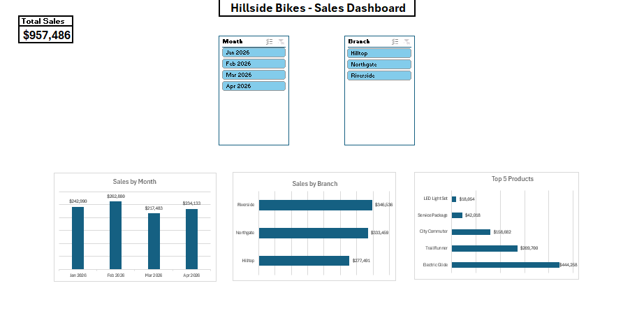

# Hillside Bikes – Excel Sales Dashboard (Practice Case Study)

*Practice project with a fictional client and generated data.\*

## The brief

Hillside Bikes has three branches and receives a sales export every month. The owner wanted a one-page Excel dashboard showing total sales, sales by branch, sales by month and top products, with slicers to filter by branch and month, and it had to refresh when a new monthly file is added.

## What I built

- **Power Query (From Folder)** combines every monthly CSV automatically.

- Cleaning rules: footer and blank rows removed, branch names trimmed and capitalised, `$` removed from amounts, dates and amounts typed with the English (US) locale.

- Product names and categories merged in from `products.csv`.

- A **ProjectFolder** parameter replaces hard-coded paths, so the file works on any PC.

- PivotTables and PivotCharts: sales by month, sales by branch, top 5 products, plus total sales.

- **Branch and Month slicers** connected to every chart and the total.

## Key findings (Jan–Apr 2026)

- Total sales: **$957,486**.

- Riverside is the strongest branch with **$346,536 (36.2%)**, followed by Northgate (34.8%) and Hilltop (29.0%).

- February was the best month (**$262,880**). March was the weakest (**$217,483**), and April recovered by 7.7%.

- Electric Glide alone brings in **46.4%** of sales ($444,258).

## Refresh test

An April file with new spelling variants was added to the folder. One **Refresh All** brought in all 1,220 rows, the branches stayed clean, and April appeared in the slicer.

## How to update

1. One-time setup: in Power Query, set **ProjectFolder** to your project folder (ending in `\`).

2. Save each new monthly CSV in `data\monthly` (don't open it first).

3. Click **Data → Refresh All**.

## Tools

Excel (Microsoft 365): Power Query, PivotTables, PivotCharts, slicers.

